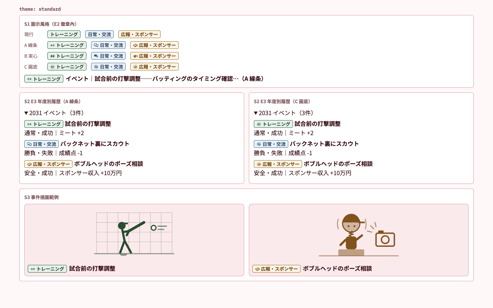
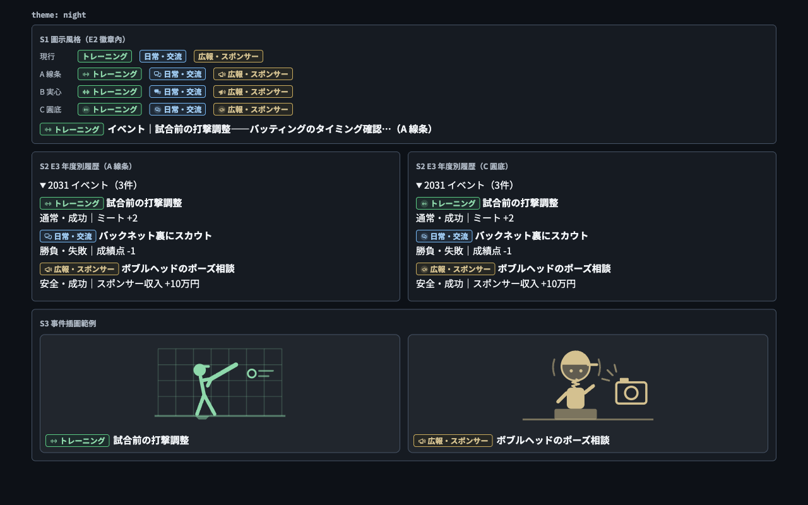
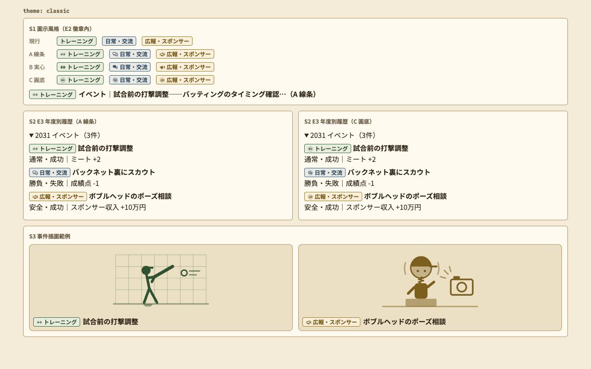
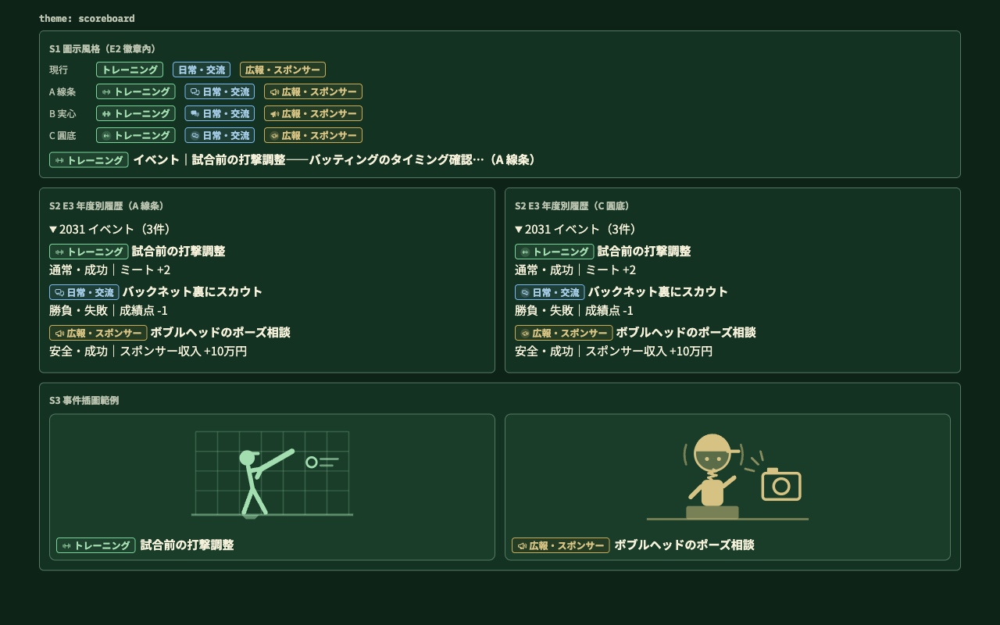
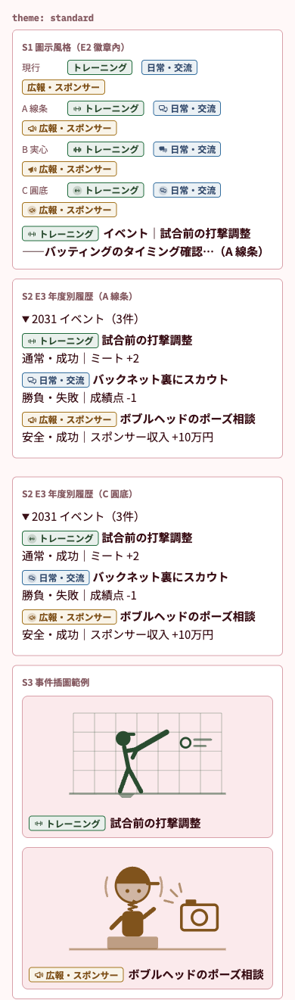
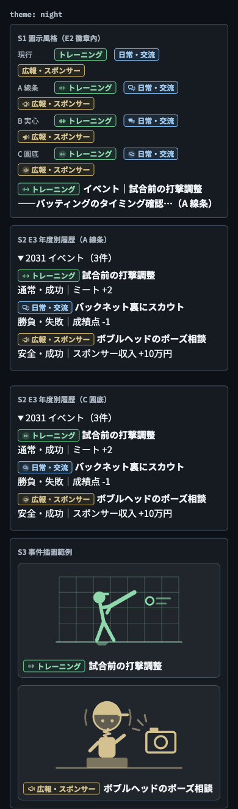
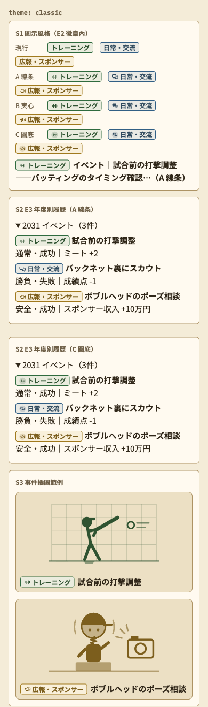
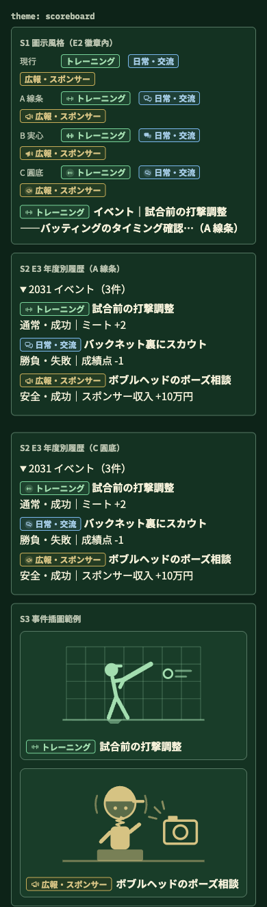

# EVT-01 事件圖示 SVG 範例（提案，未授權實作）

> 2026-11-15。僅供code owner決定方向；本PR只新增`tasks/`下的文件與範例圖，不改遊戲程式、版號、`BACKLOG.md`。
> 基準：dev `712d613`（1.16.11）。S2的E3履歷樣式取自`feat/evt-01-year-history`（PR #99，未併dev）。

## 範例檔

`tasks/evt-01-svg-samples/`，全部為手寫幾何圖形（無外部素材、無授權問題），顏色只用`currentColor`，不含`<script>`或外部參照，`xmllint`可解析。

| 檔案 | 內容 | 原始大小 | gzip後 |
|---|---|---:|---:|
| `icon-line-{training,encounter,endorsement}.svg` | A 線條：啞鈴／對話框／擴音器 | 324／448／434 B | 267／323／329 B |
| `icon-solid-*.svg` | B 實心 | 449／402／461 B | 270／305／344 B |
| `icon-disc-*.svg` | C 圓底（淡色圓＋線條） | 468／592／578 B | 344／399／405 B |
| `scene-001.svg` | 事件插圖範例：#1 試合前の打撃調整（training） | 1,169 B | 484 B |
| `scene-068.svg` | 事件插圖範例：#68 ボブルヘッドのポーズ相談（endorsement） | 1,607 B | 564 B |

預覽截圖（mock頁使用dev現行CSS與4主題token；mock頁本身不提交）：

| 寬度 | standard | night | classic | scoreboard |
|---|---|---|---|---|
| 1280 |  |  |  |  |
| 390 |  |  |  |  |

截圖時確認：8張皆無橫向捲動（`scrollWidth`＝視窗寬），徽章內圖示高約12.6px。

## 下載量

- **分類圖示（S1）：** 一種風格3個合計約1.2～1.5 KB（gzip後約0.9～1.1 KB）。若以inline SVG寫進JS／CSS，不增加請求數。對照：現行背景圖`escon-desktop.webp` 406 KB、`escon-mobile.webp` 332 KB。
- **事件插圖（S3）：** 本範例的簡單線條畫每張1.2～1.6 KB；92個事件同等複雜度約110～150 KB（gzip後約45～55 KB，估計值）。若改為細緻插畫，每張常見10～50 KB以上，92張約0.9～4.6 MB（估計值），需改為只載入顯示中的那張。
- gzip數字為參考；正式站實際是否壓縮傳送未在本PR確認。

## 待決事項

**S1 圖示風格**
- A 線條：與現行細框徽章最一致，視覺較輕。
- B 實心：小尺寸下最容易辨識。
- C 圓底：圓內圖形縮為約8.6px，徽章尺寸下細節難辨（見截圖）。
- 不加圖示（維持現行文字徽章）。

**S2 放置位置**
- a. 只加在E2徽章（選擇畫面標題＋結果卡，`eventCategoryBadge`一處）。
- b. a＋E3年度別履歷。E3目前自行組徽章DOM（`career-event-history.js`），需另改一處。
- c. b＋引退共用圖（canvas）。需以圖片繪入，會影響改行位置與圖片高度，比照1.16.6驗證。

**S3 事件插圖**
- 不做。
- 只做3張分類共用插圖。
- 92個事件逐張插圖：需決定作者與授權方式；本PR的`scene-*.svg`僅示意構圖，不代表最終畫風。

**S4 圖示顏色**
- 跟徽章文字色（`--event-*-text`，範例採用）。
- 統一用一般文字色（`--dim`或`--chalk`）。

## 若採用（實作時再定）

- 預計為純表示變更（R2表示例外）：不改抽選候選／順序、成功率、效果、RNG、存檔。
- 預期受影響的測試期待值：`event-category-badge.test`、`support/dom-snapshot.mjs`的徽章投影、`design-tokens-06.test`使用處計數、`display-preferences.test`元件色（若新增token）。實作計畫時列入T表。
- 版號與BACKLOG依實作時的決定處理；本提案不新增BACKLOG ID。
