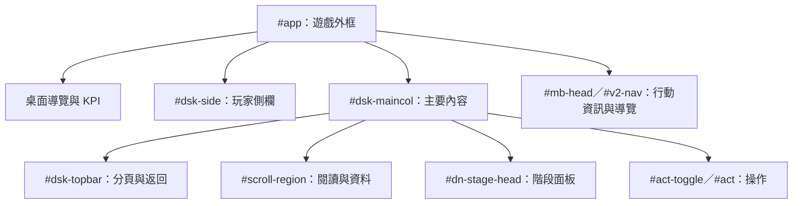

# My Baseball Days UI／DOM／CSS 設計解析

調查日期：2026-11-16（日本時間）  
對象：[My Baseball Days](https://mbday.myz.tw/index.html)，頁面顯示 v2.8.6  
用途：供「野球人生シミュレーター」評估 UI 改善與 Codex 實作規格。

## 0. 結論與證據範圍

這個網站的核心設計是「球場背景＋分層資訊面板＋持續可達的決策區」。首頁保留較多球場景觀；遊戲中則優先讓玩家看成績、讀事件與做選擇。手機版重新安排資訊位置，並不只是把桌面縮小。

本次直接讀取瀏覽器中的 DOM、同來源樣式表 CSSOM、元素的 computed style 與實際尺寸，並操作創角、主題、字級、分頁、收合、訓練復原與選單。這比單看畫面更能確認實作方式，但不是整個網站 JavaScript 原始碼或所有畫面的完整稽核。

| 證據標記 | 意義 |
|---|---|
| 實測 | 已在本次介面操作或量測確認 |
| CSS／DOM 確認 | 規則或元素確實存在，但不代表所有裝置與情境都測過 |
| 建議 | 對日文版的採用或改善方向，並非原站既有行為 |

測試角色為另外建立的「UI解析投手」，seed `7g8j7f9a`，停在 2026 年季初配點；不是先前完整生涯的 `yu3mx1o2`。投入一顆骰後已復原。檢查結束時恢復深色、文字大小 100%、瀏覽器縮放 100%，關閉公告與選單。

### 本次量測環境

| CSS 視窗尺寸 | 取得方式 | 確認範圍 |
|---|---|---|
| 1363 × 936 | 桌面 Chromium，100% 縮放 | 首頁、創角、雙欄主畫面、主題與互動 |
| 681 × 468 | 同一瀏覽器，200% 縮放 | 行動版排版、配點與收合 |
| 454 × 312 | 同一瀏覽器，300% 縮放 | 導覽、選單、閱讀區與水平溢出 |
| 340 × 234 | 同一瀏覽器，400% 縮放 | 極窄短視窗下的基本溢出檢查 |

窄版測試使用瀏覽器縮放改變 CSS viewport，屬於響應式與放大閱讀檢查，**不是 390 × 844 手機模擬，也不是 iPhone Safari 實機測試**。環境政策停用 DevTools 裝置模擬工具；沒有繞過限制。觸控、軟鍵盤、瀏海安全區與 Safari 動態工具列仍待實機確認。

## 1. 樣式來源與覆寫關係

頁面依以下順序載入四個同來源 CSS。這些不是推測檔名，而是實際 stylesheet link 與 CSSOM 來源。

| 順序 | 檔案 | 本次確認的主要內容 |
|---|---|---|
| 1 | [style.css?v=2.8.6](https://mbday.myz.tw/css/style.css?v=2.8.6) | 色彩字型變數、基礎排版、卡片、按鈕、表格、彈窗、舊有斷點 |
| 2 | [ui.css?v=2.8.6](https://mbday.myz.tw/css/ui.css?v=2.8.6) | 桌面中控台、行動資訊列、分頁與階段面板等覆寫 |
| 3 | [opening.css?v=2.8.6](https://mbday.myz.tw/css/opening.css?v=2.8.6) | 首頁球場、旅程與雲端卡片、創角、首頁響應式 |
| 4 | [console.css?v=2.8.6](https://mbday.myz.tw/css/console.css?v=2.8.6) | 遊戲中控台最終排版、透明面板、行動底部操作區與配點樣式 |

另外載入 Google Fonts 的 Noto Sans TC 與 IBM Plex Mono。其跨來源字型 stylesheet 的 `cssRules` 受瀏覽器同源政策限制，未讀取內部規則；字型名稱由頁面 link 與本地 CSS 變數確認。

### 為什麼不能只看第一個 CSS

- `ui.css` 的桌面規則曾定義 264px 側欄、彈性主欄、300px 右欄。
- `console.css` 後續以 `#app#app` 覆寫為 **320px 側欄＋彈性主欄**，本次桌面實測也確實是雙欄。
- 行動版 `#v2-nav` 在基礎規則中是底部 fixed，但最終規則改為 **position: static**，並用 Flex `order` 排到資訊列下面。
- 行動配點面板有多筆 `max-height`，最終為 **84dvh**；不能把較前面的 58dvh 當作最終值。

原站大量使用 `#app#app`、`#start#start#start` 提高選擇器權重。這是有效 CSS，不代表 DOM 有重複的同名 ID，但會提高往後修改與除錯成本。

**日文版建議：**借鏡元件結構與資訊順序；將每個元件的基礎、桌面、手機及狀態規則集中管理，避免持續疊加高權重覆寫。

## 2. DOM 結構解析

### 2.1 首頁與創角

| 實際元素 | 結構／用途 |
|---|---|
| `div#start` | 開場畫面的根容器 |
| `header.opening-header` | 版本、公告、網站功能與主題切換 |
| `#start > .wrap` | 首頁主要捲動容器 |
| `.opening-stage` | Logo／標語、旅程入口與創角內容所在區域 |
| `.opening-lobby` | 旅程卡與雲端卡的 Grid 容器 |
| `#opening-creation` | 創角畫面，含返回、說明、角色預覽與表單 |
| `#start-preview` | 姓名、守位、型態、出身、志向的即時預覽 |
| `#wizard` | 三步創角；目前／完成步驟使用狀態 class 與按鈕名稱表示 |
| `aside.start-disclaimer` | 作品聲明 |

本次實測三步依序為「守位與出手點」「投打與型態」「出身與志向」。輸入姓名後側邊預覽立即更新，完成步驟的按鈕名稱帶有「已完成」。因此是漸進揭露資訊，而非一次展示所有選項。

### 2.2 遊戲主畫面

| 實際元素 | 職責 | 設計意義 |
|---|---|---|
| `header#dsk-topnav` | 季節進度、seed、字級、閱讀、主題、保存、重新開始與公告 | 工具集中，遊戲過程不必回首頁 |
| `#dsk-kpi` | 綜合、風險、合約、武器、本季選擇與特性摘要 | 用少量數字快速理解目前狀態 |
| `aside#dsk-side` | 人物、能力、健康、武器、合約 | 詳細資料固定在主流程旁邊 |
| `#dsk-topbar` | `#dsk-hubtabs` 與 `#dn-return` | 分頁與返回待決策分開處理 |
| `#scroll-region` | `#dn-loghead`、`section#v2-panel`、`section#dn-journey`、`#log` 等 | 共用閱讀容器，在事件與資料頁之間切換 |
| `#log .card` | 標題、事件本文、選擇結果與效果 | 單一事件可作為可重用呈現單位 |
| `#dn-stage-head` | 特定生涯階段的資訊面板 | CSS 支援選秀／合約等流程的特殊版面；本次未重跑到該階段 |
| `button#act-toggle` | 展開／收合選項 | 玩家可把空間還給事件閱讀 |
| `footer#act` | 當前問題、選項、骰子配點或下一步 | 操作與長篇事件分離 |

`footer#act` 雖使用 footer 標籤，在遊戲中實際扮演決策面板。不能看到 footer 就認為它一定固定在瀏覽器底部。

手機上 `#dsk-maincol` 使用 `display: contents`，保留 DOM 層級，但不再產生自己的排版盒；其子元素參與外層 Flex 排序。這讓桌面與手機共用主要內容，而不是建立兩套事件文字。

**日文版建議：**先將「事件閱讀」「當前操作」「玩家摘要」責任分清楚。若用 `display: contents`，仍須測試閱讀器與焦點順序，不能假設視覺順序就是鍵盤順序。

## 3. CSS 版面與捲動機制

### 3.1 桌面雙欄

桌面主斷點為 `min-width: 1100px`。最終外框規則為：

| 屬性 | 最終規則／量測 |
|---|---|
| 版面 | CSS Grid |
| 最大寬 | 1408px |
| 外框留白 | 上 12px、左右 16px、下 14px |
| 欄距／列距 | 12px |
| 欄寬 | 320px＋`minmax(0, 1fr)` |
| Grid areas | 導覽跨欄、KPI 跨欄、側欄與主內容並列 |
| 高度 | 繼承基礎 `height: 100dvh` |
| 外框捲動 | `overflow: hidden`，由內部區域捲動 |

1363px 寬時，實測側欄為 320px，主要內容為 999px；符合左右留白與欄距的計算。

主要內容另外使用 Grid，列高為 `auto minmax(0, 1fr) auto auto`，分配給上方分頁、可伸縮閱讀區、特殊階段區與操作區。`min-width: 0`、`min-height: 0` 讓內部區域能縮小及產生捲動，避免長內容硬撐版面。

### 3.2 三個獨立捲動區

| 容器 | 最終樣式 | 本次桌面配點狀態量測 |
|---|---|---|
| `#dsk-side` | `overflow-y: auto` | 可視約 802px，內容 922px |
| `#scroll-region` | `overflow-y: auto` | 可視約 429px，內容 1284px |
| `#act` | `overflow-y: auto`、一般上限 40dvh | 可視與內容約 333px，當時不需捲動 |

視覺上操作區留在下方，主要原因是外框高度受控、Grid 分配剩餘空間與內層捲動。**桌面 `#act` 的 computed position 是 static，不是 fixed。**

優點是讀很長的事件時仍能找到選項。代價是滑鼠或手指所在位置不同，捲動的區域也不同；對新手可能不如整頁捲動直覺。

### 3.3 選項與配點排版

- 桌面一般選項用 `repeat(auto-fit, minmax(200px, 1fr))`，可依主欄寬度自動排列。
- 桌面配點能力卡使用 `repeat(auto-fill, minmax(290px, 1fr))`，每張卡以 Grid 配置名稱、數值、進度條與加號。
- 行動一般選項改成單欄，配點能力也改成一列一項。
- 部分「下一步」按鈕使用 `position: sticky; bottom: 0`，固定的是操作區內的按鈕位置。

**日文版建議：**不要先決定所有地方都 fixed。先選擇整頁捲動或受控高度的應用程式版面，再決定哪個容器捲動、哪個按鈕需要 sticky。

## 4. 視覺樣式解析

### 4.1 色彩與主題

| 用途 | 深色值 | 淺色遊戲值／表現 |
|---|---|---|
| 基底 `--bg` | `#0a1420` | `#f4eee3` |
| 面板 `--panel` | `#12253c` | `#fffdf8` |
| 次面板 `--panel2` | `#1a3352` | `#f6efe2` |
| 主要文字 `--chalk` | `#f2f5ef` | `#0f2338` |
| 次要文字 `--dim` | `#93a8ba` | `#6f6658` |
| 強調色 `--amber` | `#e0ac4c` | `#b06f0c` |
| 正向效果 | `--good: #6fcf9c` | 另有元件層級覆寫 |
| 負向效果 | `--bad: #ff7f6b` | 另有元件層級覆寫 |

主題由 `#app[data-theme="light"]` 等選擇器驅動，也用 `body:has(...)` 影響其他區域。實測切換後，背景圖片、面板、文字與按鈕一起改變；不是單純反轉顏色。

深色一般面板為 `rgba(18,37,60,.50)`；淺色一般面板為 `rgba(253,250,244,.86)`。操作區更實：桌面深色約 90%，淺色實測 96%；行動深色操作區直接用不透明 `#12253c`。

### 4.2 字型與字級

| 項目 | 確認值 |
|---|---|
| 本文 | Noto Sans TC，並設系統中文字型 fallback |
| 數值 | IBM Plex Mono，另含中文字型與 monospace fallback |
| 桌面一般事件本文 | 15px、行高 1.8（實測 27px）、最大寬 60em |
| 重要事件本文規則 | 16px |
| 桌面卡片標題 | 12px，字距 0.1em |
| 選項主文 | 約 15px |
| 選項副文 | 12.5px，約 1.5–1.55 行高 |
| 字卡大小滑桿 | 最小 85、最大 130、每次 5 |

實測滑桿由 100 調到 105 時，`#log` 變成 inline `zoom: 1.05`，本文 computed font-size 仍為 15px。這表示整個字卡區縮放，不只是字體變大；卡片間距、邊框及占用空間也受影響。之後已調回 100。

**日文版建議：**日文版使用適合日文的字型堆疊，字級可優先以變數控制正文與行高。若採整區 zoom，需把版面變大與捲動變化納入驗收。

### 4.3 圓角、陰影與視覺層次

- 基礎圓角變數有 8／12／16px，實際中控台大量使用 12px。
- 決策卡約 14px；行動操作區上緣約 20px；行動選單上緣 22px。
- 頂部工具與下一步按鈕多用 999px，形成膠囊形狀。
- 面板使用細邊框加陰影，讓深色畫面仍能區分邊界。
- `backdrop-filter: blur(12px)` 用於主要玻璃面板，桌面操作區另有 14px；淺色主要面板規則使用 18px 並增加飽和度。
- 選項 hover 有邊框變色與輕微上移，active 有縮放；選中的骰子有金色外框，已用骰子縮小並降低透明度。
- CSS 有 `prefers-reduced-motion: reduce` 規則，停用或減少動畫；本次確認規則存在，未切換系統動態效果偏好。

### 4.4 背景圖為什麼看得見

原站目前首頁使用 `opening-field-night-v5.webp`，淺色模式使用 sunset 版本。遊戲背景沿用這組場景。這是原站本次載入的素材名稱，不代表使用者之前提供的 ES CON FIELD 照片。

| 層次 | 首頁 | 遊戲中 |
|---|---|---|
| 場景層 | `#start::before`，fixed、cover、z-index -2 | `#app::before`，fixed、cover、z-index -1 |
| 遮罩 | 與圖片疊為兩個 background-image，深色 alpha 約 .24 → .18 → .70 | 深色 alpha 約 .52 → .60 → .74 |
| 構圖 | 一般 center；699px 以下改成 58% center | center 30% |
| 資訊卡 | 首頁 `--op-card: rgba(9,29,40,.74)` | 一般面板 .50，再疊加卡片背景 |
| 防誤觸 | 背景 pseudo-element 設 `pointer-events: none` | 同左 |
| 堆疊範圍 | 根容器 `isolation: isolate` | 同左 |

首頁以 Logo、標語與分離卡片保留球場空間。遊戲中則透過面板間隙與半透明材質帶出場景，而不是保證完整球場總是清晰可見。

透明度會累積：若 .50 面板上又疊同色 .62 事件卡，簡化計算的合成不透明度為 `1 - (1 - .50) × (1 - .62) = .81`。加上全場遮罩與模糊，球場仍可能很不明顯。因此只把最外層改成 50% 透明，未必能解決背景被擋住的問題。

**日文版背景改善方向：**

1. 首頁把標題／簡短介紹放在較透明的區域，表單與按鈕集中成獨立卡片。
2. 讓卡片外的根容器保持透明，避免一整塊深綠底從頂端蓋到底端。
3. 文字密集與實際操作區維持足夠實色背景，透景集中在頁首、邊距與卡片間隔。
4. ES CON FIELD 圖的手機 `background-position` 要依本壘、內野與玻璃牆位置實測，不直接照抄原站 58%。
5. 用 `background-size: cover` 時，直向畫面會裁掉橫圖左右兩側；這是構圖裁切，與面板遮住圖片是兩個不同問題。

## 5. 響應式設計解析

### 5.1 主要斷點

| 範圍 | CSS 確認的用途 |
|---|---|
| ≥1100px | 桌面 Grid、左側玩家資料、頂部工具列、主內容分頁 |
| ≤1099px | 行動資訊列、側欄隱藏、主欄 display: contents、Flex 重排、底部選單 |
| ≥700px | 基礎應用最大寬 760px，部分卡片間距與格線調整 |
| ≤699px | 首頁兩張卡變單欄、首頁背景偏移、部分摘要表格改排 |
| ≤399px | recap、offer-money、offer-terms 等特定格線改單欄 |
| ≤389px／359px／339px | 少數摘要表格、舊有選項與配點規則的窄版補正；仍須檢查是否被後續 CSS 覆寫 |
| 高度限制 | 另有 max-height 620／720／750／880px 等情境規則 |

斷點眾多，不應把每個數字直接搬到日文版。較適合先設定「主要桌面切換」「一般手機」「短視窗」三種產品需求，再加確有必要的元件斷點。

### 5.2 行動版閱讀順序

1. `#mb-head`：頭像、姓名、球隊、目前階段與選單。
2. 頭部內的 `#mb-stat`：綜合、受傷風險、合約、生涯薪資與檔案抽屜。
3. `#v2-nav`：主頁／養成／賽季／檔案。
4. `#scroll-region`：當前頁面的閱讀內容。
5. `#act-toggle`、`#act`：選項把手與操作面板。

`#mb-head` 的 order 為 -2，`#v2-nav` 為 -1，操作區為 2。導覽列最終在資訊列下方，**不是螢幕底部導航列**。

### 5.3 高度與安全區

- 外框使用 100dvh，意圖依動態可視高度配置。
- CSS 宣告 `--safe-b: env(safe-area-inset-bottom)`，頁面 viewport meta 有 `viewport-fit=cover`。
- 底部操作區與選單的 padding 包含 safe-b。
- 行動一般操作區最終上限 40dvh；武器選擇 64dvh；配點 84dvh。
- 行動選單 `#bd-menu-panel` 為 fixed 底部面板，最大寬 640px、最大高 88dvh，內容可自行捲動。

存在 safe-area 規則只表示有考慮安全區，不代表 iPhone 實機一定沒有遮擋；本次桌面瀏覽器量測 safe-b 為 0px。

### 5.4 實測的短視窗問題

681 × 468 的配點畫面中，頭部約 96px，導覽約 44px，加上間距、把手與約 291px 的配點區後，事件閱讀區只剩 **1px**。按「收合選項」後，閱讀區增加至 **260px**。

454 × 312、選項已收合時，閱讀區為 104px；340 × 234 時剩 26px。這兩個極短視窗在當時狀態都未發現 document 層級水平溢出，但不能據此宣稱所有表格與彈窗均不溢出。

這是縮放造成的短視窗實測結果，不代表一般直向手機也只有 1px。它仍揭露了長操作面板與固定高度配置互相競爭空間的風險。

**日文版建議：**短視窗或大字級情境允許整頁自然捲動，或切換成完整配點頁。不要為了同時塞入全部區塊而將主要閱讀區壓到不可用。

## 6. 互動狀態解析

| 互動 | DOM／CSS 機制 | 本次確認 |
|---|---|---|
| 創角選取 | `.on`、勾選符號、完成步驟文字 | 姓名預覽即時更新，三步可前進 |
| 分頁 | `button.on`；事件 `#log` 與 `#v2-panel` 顯示切換 | 檔案頁顯示時 log 為 none，panel 為 grid |
| 返回決策 | `#dn-return`／`#mb-return` | 桌面檔案頁出現返回按鈕，點擊回到原年度規劃 |
| 選項收合 | `#act.collapsed`、display none；按鈕文字改變 | 收合／展開皆成功，待選內容保留 |
| 選項情境標題 | `.title[data-ctx]::before` 透過 attr(data-ctx) 顯示年份與階段 | 實際可見「現在要決定」與年份階段 |
| 骰子狀態 | `.die.active`／`.die.used` | 投入後當前骰換到下一顆，已用骰變淡 |
| 配點復原 | `#al-undo` 的 disabled 與外觀狀態 | 初始 disabled；體力 25 → 28 後可復原，再還原為 25 |
| 主題 | `data-theme` 與 CSS 變數 | 深淺切換成功，已還原深色 |
| 字級 | range 85–130、step 5；`#log` zoom | 100 → 105 → 100 成功 |
| 閱讀模式 | 標準／精簡按鈕與 title 更新 | 切換狀態成功；未全面比對所有事件文字如何精簡 |
| 桌面公告 | `aria-expanded` 與 hidden 的 popover | 可展開，Escape 關閉 |
| 行動選單 | `aria-controls`、`aria-expanded`、`#bd-menu-panel[hidden]` | 窄版可開啟，Escape 關閉 |
| 特殊生涯階段 | `body.dn-stage`、`.dn-st-offer`、`.dn-peek` | CSS 確認；本次 UI 調查沒有進到職業合約階段 |

### 6.1 選項提供行動、效果與代價

按鈕以主文、`.choice-detail` 與效果標籤呈現資訊；正向、負向與中性分別使用 `.dn-fx-good`、`.dn-fx-bad`、`.dn-fx-neu`。例如恢復方針直接寫受傷率 -8%、體力 +1。

這種做法適合日文版：新手不用先理解完整計算公式，也能做出有理由的選擇。副文仍應保留正負符號與文字，不只用顏色表示好壞。

### 6.2 彈窗與選單

基礎 `.modal-overlay` 使用 fixed 全畫面遮罩、z-index 70、半透明深色與 3px 背景模糊；`.modal-box` 有最大高度與內部捲動。特定彈窗另外覆寫尺寸與樣式。

行動選單則用獨立 fixed 底部面板，z-index 90，透過大範圍 box-shadow 形成遮罩。它不是所有內容都塞進頁首的下拉選單。

本次開啟行動選單後，焦點仍停在開啟按鈕；Escape 可以關閉。是否有完整 Tab 焦點圈限與關閉後焦點管理尚未全面驗證。

### 6.3 無障礙與語意需要補強的地方

- 桌面分頁以 `.on` 表示選取，但本次 DOM 未見 `role="tab"` 或 `aria-selected`。
- `#act-toggle` 會改文字，當時 DOM 未見 `aria-expanded`／`aria-controls`。
- 能力加號是 `span[role="button"][tabindex="0"]`，附 aria-label；是否完整處理 Enter／Space 尚未測試。原生 button 較容易保持預期行為。
- DOM 中有些彈窗設 `role="dialog"`、`aria-modal="true"`，有些沒有；不能因為使用 modal-overlay class 就假定語意完整。
- 部分主要互動有 `:focus-visible`，且有減少動畫規則，這些值得保留。
- 本次沒有對所有背景與文字組合計算對比度，也沒有完成螢幕閱讀器測試，因此不判定 WCAG 合規與否。

## 7. 操作體驗與日文版採用評估

| 設計 | 對玩家的幫助 | 代價／風險 | 日文版採用方向 |
|---|---|---|---|
| 決策與閱讀分區 | 長事件下仍可找到下一步 | 獨立捲動區增加理解成本 | 可採，但需短視窗 fallback |
| 頂部 KPI | 快速理解當前狀態 | 與側欄／正文重複 | 只放當前決策必要的 3–4 項 |
| 返回待決策 | 查資料後不迷路 | 手機浮動入口可能覆蓋內容 | 返回按鈕保留，確認不遮住正文最後一行 |
| 選項副文與效果標籤 | 新手較易比較收益與風險 | 選項變高 | 保留短文，較長解釋可展開 |
| 創角三步 | 複雜表單可分段理解 | 增加開始前點擊次數 | 日文版欄位少時維持簡單首頁即可 |
| 卡片與側欄可收合 | 降低閱讀負擔 | 收合狀態可能不易察覺 | 保留清楚標題、數量與展開文字 |
| 空狀態說明 | 告知何時產生成績／圖表 | 首頁堆太多說明會妨礙開始 | 放在玩家主動開啟的資料頁 |
| 半透明球場背景 | 建立棒球氣氛 | 多層疊加仍會遮圖，模糊可能影響效能 | 首頁讓場景清楚，操作區優先可讀 |
| 閱讀與主題設定 | 可依環境調整 | 設定太多會增加初次負擔 | 收入設定選單，不占主流程 |

### 對既有日文版需求的具體應用

**首頁背景：**沿用使用者選定的 ES CON FIELD 照片，拆開背景、遮罩與表單卡片。讓標題區與卡片間隙露出球場，而不是縮小所有按鈕來換空間。

**存檔首頁：**維持使用者已指定的行為：沒有存檔顯示普通首頁；有存檔才顯示繼續與重新開始；刪除後立即回普通首頁，不保留刪除成功的說明卡。原站首頁雲端資訊較多，不適合直接套用到這項需求。

**首頁功能按鈕：**維持 2 × 2：第一行「表示設定／遊び方」，第二行「更新履歴／素材」。素材按鈕可縮短顯示，但開啟後的內容仍需保留作者、來源、授權與素材資訊。

**事件文字：**可學習原站字卡層次、效果標籤與收合方式。以文字為主，事件圖不應占掉手機主要閱讀與操作空間。

## 8. 建議交付 Codex 的工作批次

### P0：先處理資訊一致與小螢幕可用性

- 確認目前日文版 DOM 與 CSS，再建立閱讀區、操作區與摘要區的責任邊界。
- 為短視窗／大字級設自然捲動或獨立配點模式，避免閱讀區剩 0–1px。
- 當前階段、事件標題與決策區使用同一份狀態資料。
- 輸入與主要按鈕保持可讀、可點，不能為露背景全面縮小。

### P1：改善首頁與決策效率

- 首頁背景分層與卡片化；依照片構圖調整手機焦點。
- 存檔條件顯示、刪除後普通首頁、功能按鈕 2 × 2。
- 當前選項加入短副文、實際效果、風險與清楚確認狀態。
- 資料頁提供返回未完成選擇的入口。
- 收合按鈕補充 aria-expanded／aria-controls；分頁補選取語意。

### P2：整理長期可維護性

- 集中色彩、字級、圓角、間距與 z-index 變數。
- 合併重複或失效樣式，避免高權重選擇器層層覆寫。
- 減少動畫、背景模糊 fallback 與低效能裝置檢查。
- 季末與退休摘要採漸進展開，維持文字資訊可搜尋、可讀取。

這些是開發規格候選；本次未讀取或修改日文版當前原始碼，不宣稱全部都是它缺少的功能。

## 9. 日文版驗收清單

- [ ] 390 × 844、375 × 667、320px 寬、平板與桌面皆無主要內容遮擋。
- [ ] 橫向短視窗、200% 瀏覽器縮放、大字級仍能讀事件及完成選擇。
- [ ] iPhone Safari 軟鍵盤開啟後，姓名輸入與下一步可見。
- [ ] 主題切換後文字、錯誤、選中與停用狀態可辨識。
- [ ] 背景圖片存在時與載入失敗時，文字都能閱讀。
- [ ] 切頁、查看資料、收合後不遺失尚未確認的配點。
- [ ] 復原能還原能力與剩餘資源；確認後不重複套用。
- [ ] Tab、Enter、Space、Escape 與焦點返回行為正確。
- [ ] 有存檔／無存檔／刪除後三種首頁符合既定規格。
- [ ] 返回決策、底部按鈕與 safe-area 不互相遮擋。
- [ ] CSS 檢查以最終 computed style 為準，不以失效的早期規則下結論。

## 10. 來源與限制

主要依據為本次在 [My Baseball Days](https://mbday.myz.tw/index.html) 的 live DOM、CSSOM、computed style、視窗量測與互動結果。第 1 節列出實際載入的四個 stylesheet，供開發者重現查找；CSSOM 內容由瀏覽器正規化，因此本文件以選擇器與屬性定位，不虛構原始檔行號。

本次沒有檢查網站後端、雲端存檔、服務工作執行緒、全部 JavaScript、網路載入效能、正式對比度測試或所有職業／退休頁面。先前的完整生涯 UX 文件屬於另外一次實玩紀錄；本文件的 DOM／CSS 結論以本次 v2.8.6 載入狀態為準。

本文件記錄可借鏡的結構與互動原理，並非取得原站圖片、Logo 或完整程式碼的再利用授權。
